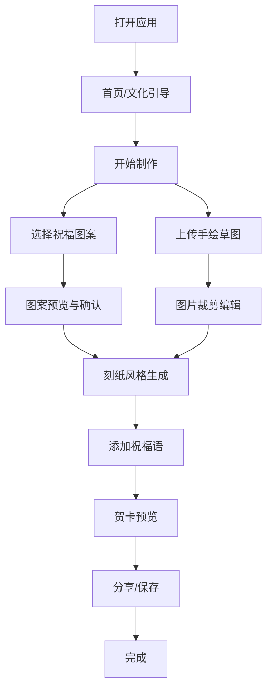

# 温州乐清细纹刻纸主题H5轻应用 - 产品需求文档

## 1. 产品概述

温州乐清细纹刻纸主题H5轻应用是一款面向移动端用户的文化互动体验应用。用户可选择代表不同国家/地区的祝福图案或上传手绘草图，生成融合温州乐清细纹刻纸艺术风格的个性化电子贺卡，并支持分享与保存。

产品目标：以数字化方式传承和推广温州乐清细纹刻纸非遗文化，同时为用户提供有趣、低门槛的个性化贺卡创作体验。

## 2. 核心功能

### 2.1 用户角色
| 角色 | 使用方式 | 核心权限 |
|------|---------|---------|
| 普通用户 | 无需注册，打开即用 | 浏览图案、上传草图、生成贺卡、分享保存 |

### 2.2 功能模块
1. **首页/引导页**：文化主题引导、应用介绍、开始制作入口
2. **图案选择页**：国家/地区祝福图案选择、刻纸风格图案预览
3. **草图上传页**：拍照/相册选择、图片裁剪旋转编辑
4. **贺卡生成页**：刻纸风格渲染、祝福语编辑、预览效果
5. **分享保存页**：一键分享、本地保存、重新制作

### 2.3 页面详情
| 页面名称 | 模块名称 | 功能描述 |
|---------|---------|---------|
| 首页 | 主题引导 | 展示细纹刻纸文化背景，提供开始制作入口 |
| 图案选择页 | 图案库 | 展示多组国家/地区与代表性图案对应关系，支持预览和选择 |
| 草图上传页 | 图片上传 | 支持拍照或相册选择，提供裁剪、旋转编辑功能 |
| 贺卡生成页 | 贺卡编辑器 | 融合刻纸风格生成贺卡，支持输入个性化祝福语 |
| 分享保存页 | 分享功能 | 支持分享至社交平台，保存至本地相册 |

## 3. 核心流程

用户打开应用后，首先进入主题引导首页，了解温州乐清细纹刻纸文化背景。点击"开始制作"后，用户可以选择"选择祝福图案"或"上传手绘草图"两条路径。

选择图案路径：用户浏览不同国家/地区的代表性图案（如樱花-日本、枫叶-加拿大、雄鹰-美国等），选择喜欢的图案后，系统将其转换为细纹刻纸风格，用户可添加祝福语，生成电子贺卡。

上传草图路径：用户拍摄或从相册选择手绘草图，进行裁剪和旋转编辑后，系统将草图转换为细纹刻纸风格，用户可添加祝福语，生成电子贺卡。

生成贺卡后，用户可以选择分享至社交平台或保存至本地相册。

## 4. 用户界面设计

### 4.1 设计风格
- **主题**：温州乐清细纹刻纸艺术风格，传统非遗文化与现代数字体验融合
- **主色调**：
  - 主色：中国红 (#C41E3A) — 代表传统喜庆与刻纸艺术常用色彩
  - 辅色：暖金色 (#D4A574) — 代表传统金箔刻纸的华贵感
  - 背景色：米白色 (#F5F0E8) — 模拟传统宣纸质感
  - 文字色：深褐黑 (#2C1810) — 传统水墨感
- **按钮样式**：采用圆角矩形（border-radius: 8px），主按钮使用中国红背景+金色边框，hover时有轻微放大效果
- **字体**：
  - 标题：书法风格字体（如"思源宋体"或"站酷文艺体"）
  - 正文：清晰易读的无衬线字体（如"PingFang SC", "Noto Sans SC"）
  - 祝福语区域：支持手写字体选择
- **布局风格**：卡片式布局，大量留白，突出文化艺术品位
- **图标/装饰**：融入细纹刻纸图案元素作为边框装饰和背景纹理

### 4.2 页面设计概览
| 页面名称 | 模块名称 | UI元素 |
|---------|---------|--------|
| 首页 | 文化引导 | 全屏背景（刻纸图案纹理），居中标题，底部开始按钮，滚动文化介绍 |
| 图案选择页 | 图案网格 | 2列网格布局，每个图案卡片包含国家标签、图案预览、选择按钮 |
| 草图上传页 | 上传编辑器 | 大面积图片预览区，底部工具栏（裁剪、旋转、确认） |
| 贺卡生成页 | 贺卡编辑器 | 贺卡预览区（占屏幕60%），祝福语输入框，字体选择，生成按钮 |
| 分享保存页 | 结果展示 | 全屏贺卡预览，底部操作栏（分享、保存、重做） |

### 4.3 响应式设计
- **设计原则**：Mobile-first，优先适配手机屏幕（375px - 428px宽度）
- **适配方案**：
  - 小屏手机（< 375px）：简化装饰元素，调整字体大小
  - 标准手机（375px - 428px）：标准布局
  - 大屏手机/平板（> 428px）：适当放大元素，保持视觉平衡
- **触摸优化**：所有按钮和可点击区域不小于 44x44px，支持触摸滑动切换图案

### 4.4 动画与交互
- **页面过渡**：采用淡入淡出（fade）效果，时长300ms
- **图案选择**：点击后卡片有轻微缩放动画（scale 0.95 -> 1），边框高亮
- **上传图片**：拖拽/选择后有淡入效果，编辑工具平滑滑入
- **贺卡生成**：生成过程中显示刻纸风格加载动画（旋转的刻纸图案）
- **微交互**：按钮点击反馈（涟漪效果），输入框聚焦时边框颜色变化

## 5. 刻纸艺术风格实现要求

### 5.1 视觉特征
- **线条**：纤细、流畅、连绵不断的曲线，模拟刻刀雕刻效果
- **图案**：镂空花纹、几何对称、民俗纹样（如花鸟、龙凤、福禄寿喜等）
- **边框**：采用传统刻纸窗花边框样式
- **层次**：通过阴影和渐变营造纸张的立体层次感

### 5.2 技术实现
- 使用 CSS 和 SVG 实现刻纸纹理和边框效果
- 通过 Canvas 或 SVG 滤镜实现图片的刻纸风格转换（边缘提取、二值化、纹理叠加）
- 背景使用微妙的刻纸图案纹理（低透明度）

## 6. 性能要求

- 页面首屏加载时间 <= 2秒（3G网络环境下）
- 交互响应时间 <= 300ms
- 图片处理时间 <= 3秒
- 支持主流移动浏览器（Chrome、Safari、微信内置浏览器）
- 适配 iOS 12+ 和 Android 8+

## 7. 成功标准

- 用户能够顺利完成从图案选择/草图上传到贺卡生成和分享的完整流程
- 刻纸艺术风格表现准确，视觉效果符合主题要求
- 在主流移动设备和浏览器上均能正常显示和运行
- 页面加载时间在3秒以内，交互响应时间在500ms以内
