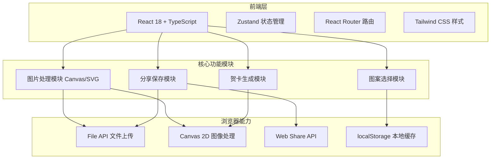

# 温州乐清细纹刻纸主题H5轻应用 - 技术架构文档

## 1. 架构设计



## 2. 技术选型

* **前端框架**：React 18 + TypeScript

* **构建工具**：Vite

* **状态管理**：Zustand

* **路由**：React Router DOM

* **样式方案**：Tailwind CSS + CSS Modules

* **图标**：Lucide React

* **图片处理**：原生 Canvas 2D API + SVG Filters

* **字体**：Google Fonts（Noto Serif SC, Ma Shan Zheng）

## 3. 路由定义

| 路由      | 用途           |
| ------- | ------------ |
| /       | 首页/文化引导页     |
| /select | 图案选择页        |
| /upload | 草图上传页        |
| /editor | 贺卡编辑页（添加祝福语） |
| /result | 贺卡结果页（分享/保存） |

## 4. 数据模型

### 4.1 图案数据

```typescript
interface Pattern {
  id: string;
  country: string;
  countryCode: string;
  symbol: string;
  symbolName: string;
  svgPath: string;
  description: string;
}
```

### 4.2 应用状态

```typescript
interface AppState {
  currentRoute: string;
  selectedPattern: Pattern | null;
  uploadedImage: string | null; // base64
  editedImage: string | null;
  greetingText: string;
  fontStyle: string;
  generatedCard: string | null; // base64
  setSelectedPattern: (pattern: Pattern) => void;
  setUploadedImage: (image: string) => void;
  setEditedImage: (image: string) => void;
  setGreetingText: (text: string) => void;
  setFontStyle: (style: string) => void;
  setGeneratedCard: (card: string) => void;
  reset: () => void;
}
```

## 5. 核心模块设计

### 5.1 图案选择模块

* 预定义图案数据数组

* 网格布局展示

* 点击选择后存入全局状态

### 5.2 图片处理模块

* **上传**：`<input type="file" accept="image/*">` + `capture` 属性支持拍照

* **编辑**：

  * 裁剪：使用自定义 Canvas 裁剪逻辑

  * 旋转：Canvas `rotate` 变换

* **刻纸风格转换**：

  * 步骤1：灰度化处理

  * 步骤2：边缘检测（Sobel 算子简化版）

  * 步骤3：二值化阈值处理

  * 步骤4：叠加刻纸纹理

  * 步骤5：应用红色/金色主题色

### 5.3 贺卡生成模块

* Canvas 合成：背景层 + 图案层 + 边框层 + 文字层

* 祝福语编辑：`<textarea>` + 字体选择

* 实时预览

### 5.4 分享保存模块

* **分享**：使用 Web Share API（移动端兼容），fallback 为复制链接/图片

* **保存**：`<a download>` 触发下载，或调用 `canvas.toDataURL()`

## 6. 性能优化策略

* 图片压缩：上传后限制最大分辨率（1200x1200）

* Canvas 离屏渲染：使用 OffscreenCanvas（如支持）

* 懒加载：图案资源按需加载

* 缓存：使用 localStorage 缓存用户编辑状态

* 动画优化：使用 CSS transform 和 opacity 实现动画，启用 GPU 加速

## 7. 项目结构

```
paper-cutting-h5/
├── public/
│   └── patterns/           # 预置图案 SVG
├── src/
│   ├── components/         # 公共组件
│   │   ├── PaperCutBorder.tsx
│   │   ├── LoadingSpinner.tsx
│   │   └── DecorativePattern.tsx
│   ├── pages/              # 页面组件
│   │   ├── HomePage.tsx
│   │   ├── PatternSelectPage.tsx
│   │   ├── SketchUploadPage.tsx
│   │   ├── CardEditorPage.tsx
│   │   └── ResultPage.tsx
│   ├── hooks/              # 自定义 Hooks
│   │   ├── useImageProcessor.ts
│   │   └── usePaperCutEffect.ts
│   ├── utils/              # 工具函数
│   │   ├── imageUtils.ts
│   │   └── patternData.ts
│   ├── store/              # Zustand 状态管理
│   │   └── useAppStore.ts
│   ├── App.tsx
│   ├── main.tsx
│   └── index.css
├── index.html
├── package.json
├── tailwind.config.js
├── postcss.config.js
├── tsconfig.json
└── vite.config.ts
```

## 8. 关键技术实现点

### 8.1 刻纸风格滤镜算法

```typescript
// 核心步骤
function applyPaperCutEffect(canvas: HTMLCanvasElement) {
  const ctx = canvas.getContext('2d');
  const imageData = ctx.getImageData(0, 0, canvas.width, canvas.height);
  const data = imageData.data;
  
  // 1. 灰度化
  for (let i = 0; i < data.length; i += 4) {
    const gray = data[i] * 0.299 + data[i+1] * 0.587 + data[i+2] * 0.114;
    data[i] = data[i+1] = data[i+2] = gray;
  }
  
  // 2. 边缘检测 + 二值化
  // ...
  
  // 3. 应用主题色（中国红）
  for (let i = 0; i < data.length; i += 4) {
    if (data[i] < 128) {
      data[i] = 196;     // R
      data[i+1] = 30;    // G
      data[i+2] = 58;    // B
    }
  }
  
  ctx.putImageData(imageData, 0, 0);
}
```

### 8.2 SVG 刻纸边框

* 使用 SVG `path` 绘制传统窗花纹样

* 通过 `stroke-dasharray` 和渐变实现刻刀痕迹效果

* 复用边框组件包裹贺卡内容

## 9. 兼容性要求

* iOS Safari 12+ / Chrome 80+

* Android Chrome 80+ / WebView

* 微信内置浏览器

* 不支持 Web Share API 的浏览器使用 fallback 方案

